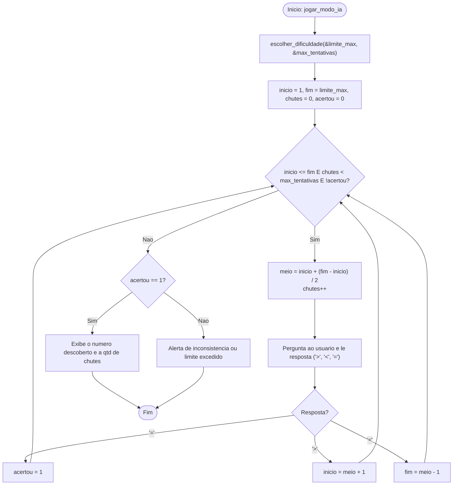

# Projeto x1 - Adivinhe o Número do Vilão (Cipher)

## Descrição

Você foi capturado pelo vilão **Cipher** e precisa hackear o terminal dele adivinhando o código de acesso numérico antes que o alarme dispare. O sistema conta com dois modos de jogo, níveis de dificuldade configuráveis, histórico colorido de palpites (quente/frio via códigos ANSI), validação robusta de entrada e ranking persistente em arquivo (`ranking.txt`).

### Funcionalidades
- **Menu Principal (`switch`)**:
  1. **Modo Humano**: o computador sorteia um número secreto e o jogador tenta acertar usando dicas de maior/menor e termômetro de proximidade (cores ANSI), com limite de $\lceil \log_2(N) \rceil$ tentativas.
  2. **Modo IA (Busca Binária)**: você pensa em um número e o computador descobre em no máximo $\lceil \log_2(N) \rceil$ chutes respondendo com `>`, `<` ou `=`.
  3. **Ranking (Top 10)**: exibe os 10 melhores resultados (menor número de tentativas), salvos e carregados automaticamente em `ranking.txt`.
- **Níveis de Dificuldade**:
  - Fácil: `1` a `100` (máx. `7` tentativas)
  - Médio: `1` a `1000` (máx. `10` tentativas)
  - Difícil: `1` a `10000` (máx. `14` tentativas)
- **Modularização e Memória**:
  - `main.c`: fluxo principal e menu (sem vetores globais).
  - `jogo.h` / `jogo.c`: lógica dos modos de jogo, validação de entrada e histórico dinâmico (`malloc` / `free`).
  - `ranking.h` / `ranking.c`: definição de `struct Jogador`, ordenação e persistência em `ranking.txt`.

---

## Instruções de Compilação e Execução

Compile com `gcc` seguindo o padrão C99 e flags estritas:

```powershell
gcc -std=c99 -Wall -Wextra -pedantic main.c jogo.c ranking.c -o cipher.exe -lm
.\cipher.exe
```

---

## Fluxograma da Função Principal do Modo IA (`jogar_modo_ia`)



---

## Análise de Complexidade

### 1. Modo IA (Busca Binária) vs. Força Bruta
- **Tempo da Busca Binária:** $O(\log_2 N)$
  A cada chute (`meio`), o algoritmo descarta metade do intervalo de busca restante (`inicio` até `fim`). Como o espaço de busca cai pela metade a cada passo ($N \rightarrow N/2 \rightarrow N/4 \rightarrow \dots \rightarrow 1$), o número máximo de passos no pior caso é:
  $$\lceil \log_2(N) \rceil$$
  - Fácil ($N = 100$): $\lceil \log_2(100) \rceil = 7$ tentativas.
  - Médio ($N = 1000$): $\lceil \log_2(1000) \rceil = 10$ tentativas.
  - Difícil ($N = 10000$): $\lceil \log_2(10000) \rceil = 14$ tentativas.
- **Comparação com Força Bruta:** Uma busca linear chutando `1, 2, 3, ...` teria complexidade $O(N)$ no pior caso (até `1000` chutes no modo Médio), sendo inviável dentro do limite de `10` tentativas.
- **Espaço da Busca Binária:** $O(1)$, pois utiliza apenas variáveis simples (`inicio`, `fim`, `meio`, `chutes`).

### 2. Modo Humano e Histórico de Palpites
- **Tempo do loop do jogo:** limitado a no máximo $M = \lceil \log_2(N) \rceil$ rodadas. Como a cada rodada o histórico exibido possui tamanho $0, 1, \dots, M-1$, o custo total de exibição do histórico ao longo de toda a partida é $O(M^2) = O((\log N)^2)$.
- **Espaço do histórico:** $O(M) = O(\log N)$, alocado dinamicamente com `malloc` exatamente para `max_tentativas` inteiros e liberado com `free` ao término da rodada.

### 3. Ranking (Top 10)
- **Tempo de inserção/ordenação:** utiliza *Insertion Sort* sobre um vetor de no máximo $K = 10$ elementos. Embora *Insertion Sort* seja $O(K^2)$ no caso geral, como $K$ é uma constante pequena e fixa ($K \le 10$), o tempo real é constante $O(1)$.
- **Espaço:** $O(K) = O(1)$, utilizando o vetor local `Jogador ranking[10]` passado por ponteiro entre as funções.

---

## Estruturas de Dados e Uso de Ponteiros

### Estruturas de Dados Escolhidas

1. **`struct Jogador` (`ranking.h`)**
   - Agrupa de forma coesa os dois atributos de cada recorde (`char nome[MAX_NOME]` e `int tentativas`).
   - Permite manipular cada entrada do ranking como uma única unidade em memória, simplificando a ordenação, a persistência em `ranking.txt` e a passagem por parâmetro entre funções.

2. **Vetor estático local `Jogador ranking[MAX_RANKING]` (`main.c`)**
   - Escolhido por ter capacidade pequena e fixa (Top 10) e por atender à regra de **não utilizar vetores globais**.
   - Fica alocado na pilha da função `main` e é compartilhado apenas via ponteiro com as funções que precisam lê-lo ou atualizá-lo.
   - Mantido ordenado do menor para o maior número de tentativas via *Insertion Sort* (`ordenar_ranking` em `ranking.c`), aproveitando o baixo custo para até 10 elementos.

3. **Vetor dinâmico `int *historico` (`jogar_modo_humano` em `jogo.c`)**
   - Escolhido porque o limite máximo de tentativas (`max_tentativas = ceil(log2(limite_max))`) só é conhecido em tempo de execução após a escolha da dificuldade (7, 10 ou 14).
   - Alocado sob medida com `malloc((size_t)max_tentativas * sizeof(int))` no início da partida e obrigatoriamente liberado com `free(historico)` ao término da função.

### Como os Ponteiros Funcionam neste Projeto

Em C, argumentos são passados por valor (cópias). Ponteiros armazenam endereços de memória (`&` obtém o endereço; `*` acessa ou altera o conteúdo naquele endereço), sendo usados no projeto em cinco cenários principais:

1. **Retornar múltiplos valores de uma função (`escolher_dificuldade`)**
   - `jogar_modo_humano` e `jogar_modo_ia` passam `&limite_max` e `&max_tentativas`.
   - `escolher_dificuldade(int *limite_max, int *max_tentativas)` altera diretamente as variáveis originais usando `*limite_max` e `*max_tentativas`, além de `obter_cor_temperatura` usar `const char **rotulo` para devolver o rótulo textual junto ao retorno da cor ANSI.

2. **Compartilhar e atualizar o ranking sem variáveis globais**
   - O vetor `ranking` decai naturalmente para `Jogador *ranking` ao ser passado como argumento, e o contador é passado como `&total_ranking` (`int *total`).
   - Assim, `carregar_ranking`, `registrar_no_ranking` e `jogar_modo_humano` conseguem atualizar tanto os registros do vetor quanto a quantidade real `(*total)++`.

3. **Gerenciamento dinâmico de memória (`malloc` / `free`)**
   - `int *historico` recebe o endereço do bloco alocado no *heap* por `malloc`, é indexado normalmente como `historico[tentativas]` durante o jogo e devolvido ao sistema operacional com `free(historico)` (seguido de `historico = NULL`).

4. **Proteção de leitura com `const`**
   - Funções que apenas leem dados (`exibir_ranking`, `salvar_ranking`, `exibir_historico`, `ler_inteiro_intervalo`) recebem ponteiros `const`, evitando cópias desnecessárias e impedindo alterações acidentais em tempo de compilação.

5. **Manipulação de arquivos (`FILE *fp`)**
   - `fopen` retorna um ponteiro `FILE *` para o fluxo do arquivo `ranking.txt` (ou `NULL` caso não exista na leitura inicial), utilizado em `fscanf`, `fprintf` e fechado com `fclose`.
